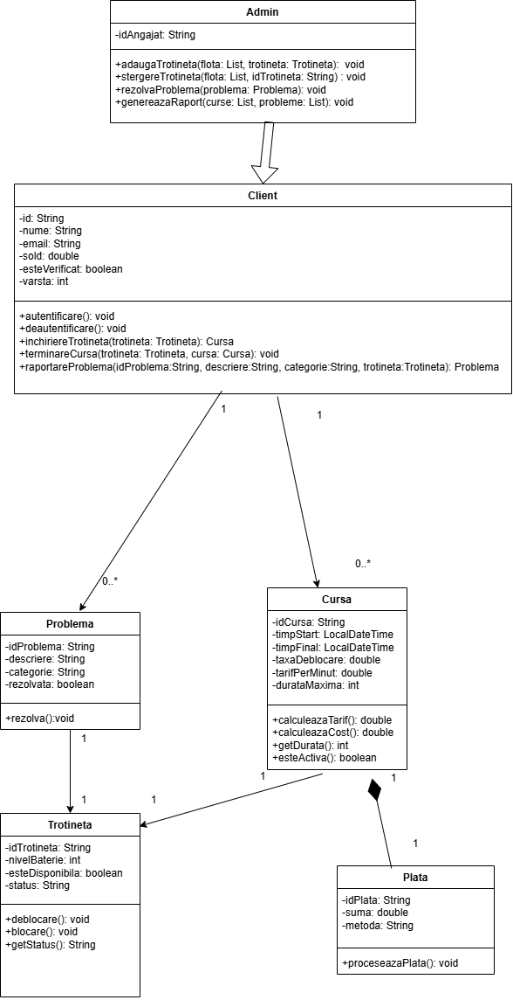
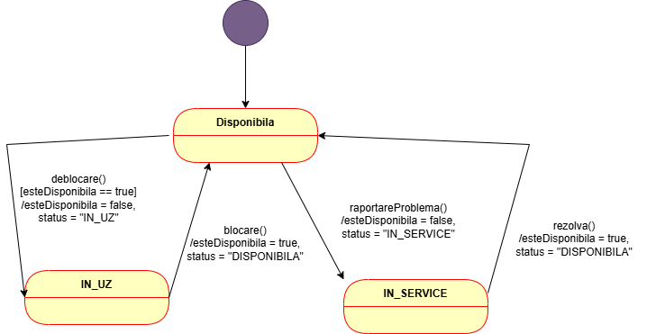

# Electric Scooter Management Application

Java console application for managing an electric scooter rental fleet: clients rent scooters and report problems, while administrators manage the fleet, resolve issues and generate reports.

## Tech Stack
- Java
- JUnit

## Features
- Scooter rental with validations (verified account, minimum age 16, sufficient balance, minimum battery level 15%)
- Ride cost calculation: unlock fee + per-minute rate, night surcharge (22:00–06:00), penalty for exceeding 120 minutes and discount for rides over 60 minutes
- Payment processing for finished rides
- Problem reporting by category (battery, malfunction, accident)
- Fleet management for administrators (add / remove scooters, resolve problems)
- Administrator report: revenue, ride statistics and problem status
- Unit tests for clients, administrators and rides

## Project Structure
```
src/
├── app/      # Main – demo of the complete flow
├── modele/   # Client, Admin, Trotineta, Cursa, Plata, Problema
└── teste/    # JUnit tests
```

## Diagrams

### Class diagram


### Scooter state diagram

